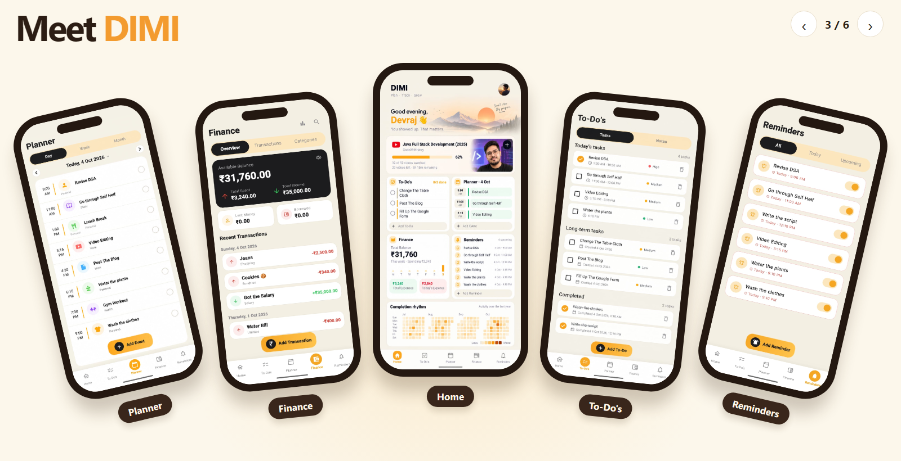

# DIMI

### Plan. Track. Grow.

  

**A four-month solo project built by a CSE engineering student.** DIMI brings
planning, tasks, reminders, notes, study progress, and money tracking together
in one app. It is designed to help students stay organised and keep their day
moving.

  <a href="https://dimiapp.vercel.app"><strong>Visit DIMI</strong></a>
  &nbsp; · &nbsp;
  <a href="https://github.com/incognito-devraj/DIMI/releases/latest/download/DIMI.apk"><strong>Download for Android</strong></a>
  &nbsp; · &nbsp;
  <a href="https://github.com/incognito-devraj/DIMI/releases"><strong>What's new</strong></a>

## What DIMI does

- Plan your day and keep track of classes and events.
- Manage tasks, notes, and reminders in one place.
- Track everyday spending and income.
- Follow study goals and YouTube playlist progress.
- Use core features offline, with optional Google sign-in and cloud sync.

## Built with

- **Flutter and Dart** for the Android app.
- **Riverpod** for app state.
- **Drift and SQLite** for on-device data.
- **Supabase** for sign-in and cloud sync.
- **Kotlin** for Android reminder features.
- **Vercel** for the DIMI website.

Made by [incognito-devraj](https://github.com/incognito-devraj).
